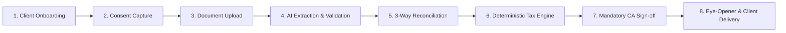

# CA Bharat AI — Enterprise Frontend Prototype
### AI-Powered, CA-Led Tax Workflow Automation & Personal Finance Intelligence for India

> **Core Philosophy**: **AI + Rules Engine + Human Approval**  
> *"AI assists the Chartered Accountant; it does not independently make tax decisions, calculate tax liability via probabilistic LLMs, or approve and submit statutory returns."*

---

## 1. Executive Summary & Purpose

**CA Bharat AI** is an enterprise financial SaaS platform designed specifically for Indian Chartered Accountants and tax advisory firms. It automates manual tax workflows, cross-audits multi-source tax documents (Form 16 vs 26AS vs AIS/TIS), executes deterministic Old vs Section 115BAC New Tax Regime optimizations, and generates client-facing personal finance intelligence (Annual Financial Eye-Opener).

This repository contains the complete, interactive **Phase 1 MVP Frontend Prototype**, built directly from the official **CA Bharat AI Developer Briefing Document**.

---

## 2. Developer Briefing Compliance Matrix

| Briefing Requirement | Functional Specification | Prototype Component / File | Interactive Implementation |
| :--- | :--- | :--- | :--- |
| **1. User & Firm Management** | Create firms, users, roles & access permissions | [FirmClientsModule.jsx](file:///src/components/modules/firm-clients/FirmClientsModule.jsx) & [SettingsModule.jsx](file:///src/components/modules/settings/SettingsModule.jsx) | Firm profile (Sharma & Co., FRN 014829N), RBAC staff invitations (Partner FCA, Senior ACA, Junior). |
| **2. Client Management** | Client master profiles & assessment year cases | [FirmClientsModule.jsx](file:///src/components/modules/firm-clients/FirmClientsModule.jsx) | Onboard taxpayers with PAN, Aadhaar (last 4), category, employer TAN, salary, and active AY case tagging. |
| **3. Consent Management** | Capture DPDP client consent & purpose | [FirmClientsModule.jsx](file:///src/components/modules/firm-clients/FirmClientsModule.jsx) | Explicit consent records, purpose specification, timestamped logs, and simulated WhatsApp intake links. |
| **4. Document Management** | Upload Form 16, AIS, TIS, 26AS, capital gains | [DocumentIntelligenceModule.jsx](file:///src/components/modules/document-intelligence/DocumentIntelligenceModule.jsx) | Multi-category document vault with password-protected PDF unlock concept and classification badges. |
| **5. AI Document Extraction** | Extract tax information with source references | [DocumentIntelligenceModule.jsx](file:///src/components/modules/document-intelligence/DocumentIntelligenceModule.jsx) | Multi-step simulated AI extraction animation, OCR confidence scores, and bounding-box coordinate citations. |
| **6. Data Validation** | Identify missing, invalid & low-confidence fields | [DocumentIntelligenceModule.jsx](file:///src/components/modules/document-intelligence/DocumentIntelligenceModule.jsx) | Cross-document validation alerts flagging omitted dividend or savings interest before return filing. |
| **7. Reconciliation Engine** | Compare values across documents & highlight mismatches | [TaxReconciliationModule.jsx](file:///src/components/modules/tax-reconciliation/TaxReconciliationModule.jsx) | 3-Way Cross-Reconciliation Matrix (Form 16 vs 26AS vs AIS/TIS) with interactive *"Accept & Add"* mismatch resolution. |
| **8. Tax Calculation Engine** | Deterministic calculations using version-controlled rules | [taxCalculator.js](file:///src/utils/taxCalculator.js) | 100% deterministic arithmetic comparison of Old Regime vs Section 115BAC New Regime with standard deduction & 4% cess. |
| **9. CA Review & Approval** | Mandatory CA approval, rejection or correction request | [TaxReconciliationModule.jsx](file:///src/components/modules/tax-reconciliation/TaxReconciliationModule.jsx) | 6-point pre-approval checklist, editable partner review notes, simulated DSC hash generation, and celebration trigger. |
| **10. Report Generation** | Annual financial snapshots & client reports | [InsightsDeliveryModule.jsx](file:///src/components/modules/insights-delivery/InsightsDeliveryModule.jsx) | 2-Page Visual Financial Eye-Opener PDF report with firm branding, assumptions, and demonstration watermark. |
| **11. Client Communication** | Draft client queries & document requests | [InsightsDeliveryModule.jsx](file:///src/components/modules/insights-delivery/InsightsDeliveryModule.jsx) | Personalized WhatsApp drafts for discrepancy notices, filing pack confirmations, and Q4 advance tax reminders. |
| **12. Audit & Monitoring** | Record activities, changes, approvals & system events | [InsightsDeliveryModule.jsx](file:///src/components/modules/insights-delivery/InsightsDeliveryModule.jsx) | Chronological immutable audit trail capturing user, action, category, IP address, and timestamp. |

---

## 3. Strict AI Boundaries & Guardrails

As specified in **Section 6 of the Developer Briefing Document**, the system maintains strict guardrails between probabilistic AI and deterministic legal compliance:

```
┌───────────────────────────────────────────────┐
│              CA BHARAT AI PLATFORM            │
├───────────────────────┬───────────────────────┤
│    WHAT AI CAN DO     │   WHAT AI NEVER DOES  │
├───────────────────────┼───────────────────────┤
│ ✓ Read & extract PDFs │ ✕ No LLM tax math     │
│ ✓ Bounding box quotes │ ✕ No data overwrite   │
│ ✓ Flag discrepancies  │ ✕ No auto-filing      │
│ ✓ Draft communications│ ✕ No fund transfers   │
│ ✓ Summarize insights  │ ✕ No unreviewed advice│
└───────────────────────┴───────────────────────┘
```

- **Deterministic Computation**: Tax liabilities are computed using hardcoded arithmetic functions in `taxCalculator.js` based on statutory Income Tax Department slab rules, never prompted through LLMs.
- **Mandatory Human-in-the-Loop**: Returns cannot progress to filing without formal sign-off by a licensed Chartered Accountant (FCA/ACA).
- **Zero Live Government Submission**: This is a prototype demonstration — no real PAN data is sent to the CBDT Income Tax Portal.

---

## 4. End-to-End Application Workflow



1. **Client Onboarding & Intake**: Create taxpayer profile with PAN, category, and assigned staff member.
2. **Consent Recording**: Capture time-stamped purpose-limited consent under DPDP principles.
3. **Multi-Source Ingestion**: Ingest Form 16 Part A & B, Form 26AS, and AIS/TIS annual statements.
4. **Extraction with Evidence**: OCR layout parsing with coordinate bounding box citations and confidence scores.
5. **3-Way Reconciliation**: Highlight cross-document differences (e.g., unreported savings interest or mutual fund capital gains).
6. **Regime Optimization**: Automatically evaluate Old Regime deductions vs New Regime Section 115BAC tax relief.
7. **CA Review & Gateway**: Review pre-approval checklist, enter audit notes, and execute simulated sign-off.
8. **Client Delivery & Wealth Advisory**: Dispatch 2-page visual financial eye-opener and quarterly advance tax tracking.

---

## 5. Technology Architecture

- **Framework**: React 19 + Vite 8
- **Language**: JavaScript (ES6+ Modules)
- **Styling**: Tailwind CSS v4 with custom sovereign color tokens:
  - *Midnight Sovereign Blue (`#0B132B` / `#0F172A`)*
  - *Heritage Amber Gold (`#F59E0B` / `#D97706`)*
  - *Royal Azure (`#0284C7` / `#2563EB`)*
  - *Compliant Emerald (`#059669`)*
- **Typography**: Google Fonts **Plus Jakarta Sans** (UI typography) and **JetBrains Mono** (currency & PAN numbers)
- **Icons**: Lucide React
- **Data Visualizations**: Recharts (Responsive bar and pie charts)
- **State & Persistence**: React Context (`AppContext.jsx`) with LocalStorage synchronization and factory demo reset
- **Performance Benchmarking**: Grafana k6

---

## 6. Project Directory Structure

```
ca-bharat/
├── public/                     # Static assets & brandmark favicon
├── src/
│   ├── components/
│   │   ├── common/             # Reusable UI primitives (Logo, Modal, Badge)
│   │   ├── layout/             # AppLayout, Sidebar, Topbar
│   │   └── modules/
│   │       ├── dashboard/      # Main Dashboard & Mission Control
│   │       ├── firm-clients/   # Module 1: Firm & Client Operations
│   │       ├── document-intelligence/ # Module 2: Document Vault & OCR
│   │       ├── tax-reconciliation/    # Module 3: 3-Way Recon & Regime Engine
│   │       ├── insights-delivery/     # Module 4: Eye-Opener & Advisory
│   │       ├── settings/       # Firm Settings & DPDP Configuration
│   │       └── help/           # Compliance Guides & Golden Architecture Rule
│   ├── context/
│   │   └── AppContext.jsx      # Unified reactive state & LocalStorage provider
│   ├── data/
│   │   └── mockData.js         # Coherent fictional Indian tax dataset
│   ├── utils/
│   │   ├── formatters.js       # INR currency, dates, and PAN masking
│   │   ├── insightsHelper.js   # Financial snapshot & wealth action models
│   │   ├── storage.js          # LocalStorage persistence wrapper
│   │   └── taxCalculator.js    # Deterministic Old vs New Regime calculation
│   ├── App.jsx                 # Client-side router configuration
│   ├── index.css               # Tailwind v4 theme & typography declarations
│   └── main.jsx                # Application root mount
├── tests/
│   └── performance/
│       └── k6/
│           └── smoke-test.js   # Grafana k6 baseline performance script
├── index.html                  # HTML shell with font preloads & vector favicon
├── package.json                # Project dependencies & npm scripts
└── vite.config.js              # Vite bundler configuration
```

---

## 7. Quality & Verification Standards

### Static Code Analysis (`npx oxlint`)
- **0 errors, 1 warning** (Fast Refresh idiom on React Context hook)
- Verified clean imports, zero dead variables, and zero React Compiler render-purity warnings.

### Build Verification (`npm run build`)
- Successfully transforms 525 modules into production distribution chunks in **~275ms**.

### Grafana k6 Baseline Performance Test
```powershell
npm run test:perf
# or: k6 run -e BASE_URL="http://127.0.0.1:5173" tests/performance/k6/smoke-test.js
```
- **Checks Passed**: 100.00% (60 / 60)
- **HTTP Failure Rate**: 0.00%
- **Average Response Latency**: 2.37ms
- **p95 Latency**: 3.45ms

---

## 8. Getting Started

### Prerequisites
- Node.js 18+ and npm
- (Optional) Grafana k6 for running performance benchmarks

### Installation & Local Development
```powershell
# Clone or navigate to the project directory
cd "d:\projects\ca Bharat"

# Install dependencies
npm install

# Start development server
npm run dev
# Server will start on http://127.0.0.1:5173/

# Run production build
npm run build

# Run Grafana k6 performance smoke test
npm run test:perf
```

---

## 9. Roadmap to Production (Phase 1 to Phase 4)

- **Phase 1 (MVP - Current Prototype)**: Tax workflow, consent demonstration, simulated OCR extraction with coordinate citations, 3-way reconciliation, deterministic Old vs New regime optimizer, mandatory CA review, and annual financial snapshot.
- **Phase 2 (Monthly Insights)**: Bank statement auto-categorization, spending vs savings trend analytics, and quarterly advance tax tracking.
- **Phase 3 (Partner Ecosystem)**: SEBI-registered Investment Advisor (RIA) referral integration and mutual fund portfolio rebalancing.
- **Phase 4 (Agentic AI)**: Bounded, read-only AI agents for document completeness triage, missing information chasers, and automated return draft staging under CA sign-off.
