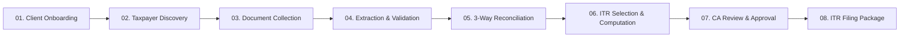

# CA Bharat AI — Enterprise Tax Platform & Statutory Workflow Engine
### AI-Assisted, CA-Led Tax Compliance, Reconciliation & Personal Finance Intelligence for India

> **Core Philosophy**: **AI + Deterministic Rules Engine + Mandatory CA Sign-off**  
> *"AI assists the Chartered Accountant; it does not independently make tax decisions, calculate tax liability via probabilistic LLMs, or submit unapproved returns to the CBDT portal."*

---

## 🌐 Live Production Deployment

- **Live Web Application:** [https://ca-bharat-ai.onrender.com](https://ca-bharat-ai.onrender.com)
- **Live Backend API & Rules Engine:** [https://ca-bharat-backend.onrender.com](https://ca-bharat-backend.onrender.com)
- **Statutory Assessment Year:** AY 2025-26 (Finance Act 2024 & CBDT Rule 12)
- **Current Deployed Architecture:** React 19 Frontend + FastAPI Backend + PostgreSQL Database + Deterministic Tax Engine

---

## 1. Executive Summary & Purpose

**CA Bharat AI** is an enterprise financial SaaS platform built specifically for Indian Chartered Accountants, tax practitioners, and audit firms. It streamlines the statutory compliance lifecycle from client onboarding and discovery to multi-source document extraction, 3-way reconciliation (Form 16 vs 26AS vs AIS/TIS), Rule 12 ITR form selection, regime optimization (Old vs Section 115BAC New Regime), and final ITR filing preparation.

---

## 2. Statutory 8-Stage Compliance Workflow



1. **Client Onboarding (Stage 01):** Legal entity classification (Section 2(31)), PAN format validation, and DPDP Act 2023 digital consent logging.
2. **Taxpayer & Income Details (Stage 02):** Dynamic discovery questionnaire capturing salary, multiple house properties, business turnover (44AD/44ADA), capital gains, unlisted directorships, and foreign assets.
3. **Document Collection (Stage 03):** 1-Click **"Upload Docs"** button right in front of each customer in the client directory and existing customers modal.
4. **Document Extraction & Validation (Stage 04):** Deterministic extraction of Form 16, 26AS, and AIS/TIS with coordinate bounding box citations and confidence scores.
5. **Reconciliation (Stage 05):** 3-Way cross-audit matrix matching salary income, TDS tax credits, and flagging unreported savings bank or dividend interest.
6. **ITR Selection & Tax Computation (Stage 06):** Deterministic evaluation under CBDT Rule 12 comparing Old vs Section 115BAC New Tax Regime with ₹75,000 standard deduction and 4% health & education cess.
7. **CA Review & Approval (Stage 07):** 6-point statutory pre-approval audit checklist, partner review notes, cryptographic sign-off hash, and return-for-correction workflow.
8. **ITR Filing Preparation (Stage 08):** Generation of validated, CBDT-compliant ITR JSON packages and taxpayer financial audit summaries.

---

## 3. Key Recent Features & UI Improvements

### A. Intelligent Rule 12 Auto-Engine (No Premature Form Guessing)
- Previously, users had to guess which ITR form a taxpayer required at Step 1.
- Now, the intake profile includes **`Multiple Income Streams / Don't Know (Auto-Detect via AI Engine)`**.
- For complex assessees (e.g. salary + stock trading + multiple rental houses + directorship in father's private company), the system automatically disqualifies ITR-1, ITR-2, and ITR-4 under Rule 12 and recommends **ITR-3** with full statutory legal citations.

### B. 1-Click "Upload Docs" In Front of Every Customer
- An intuitive **Upload Docs** button is positioned directly on each client row in the **Customer Directory** (`Firm & Clients`) and on every card inside the **Existing Customers** popup.
- Clicking this immediately activates that taxpayer and opens their document vault without navigating through unrelated menus.

### C. Full Backend Persistence & PAN Validation for Newly Added Taxpayers
- **Real-Time PostgreSQL Synchronization:** Newly onboarded taxpayers and Step 2 Discovery questionnaire answers immediately persist via `POST /api/clients` and `PUT /api/clients/{pan}/intake` (with automatic pre-upload sync recovery for draft local entries), preventing `Client not found` / ownership mismatch errors during PDF uploads.
- **Strict 10-Character PAN Validation:** Enforces statutory `[5 Letters][4 Digits][1 Letter]` validation cleanly during onboarding and profile edits.
- **Multi-Source End-to-End Parity:** Verified full 8-stage pipeline from new multi-income client onboarding (`MULTI_INCOME_UNSURE` -> Rule 12 `ITR-3` selection) to document extraction, reconciliation, tax calculation, CA sign-off, and filing JSON export with zero hardcoded taxpayer leakage.

---

## 4. Testing & Demonstration Credentials

The deployed environment supports role-based access control with pre-seeded synthetic demo accounts:

| Role | Email / Username | Password | Permissions |
|---|---|---|---|
| **CA Partner** | `ca.partner@cabharat.demo` | `DemoPartner!2026` | Full audit sign-off, firm-wide administration, client onboarding & filing approval |
| **CA Senior Associate** | `ca.staff@cabharat.demo` | `DemoStaff!2026` | Document review, mismatch resolution, discovery interview updates |
| **Client (Salaried)** | `arun.verma@demo.in` | `DemoArun!2026` | Arun Kumar Verma (Salaried assessee demo portal) |
| **Client (Doctor)** | `dr.radhika@senclinic.in` | `DemoRadhika!2026` | Dr. Radhika Sen (Medical professional u/s 44ADA demo) |

---

## 5. Sample Test Documents for Uploading

Pre-configured sample PDFs for **AY 2025-26** testing are located in the repository at:
📂 `Sample_Tax_Documents_For_Testing/`

| File Name | Document Type | Data Contained |
|---|---|---|
| `01_Form16_Salary_TCS.pdf` | Form 16 Part A & B | Gross Salary ₹15,20,000, Std Deduction ₹75,000, TDS ₹1,18,560 |
| `02_Form26AS_TaxCredit_TRACES.pdf` | TRACES Statement | Verified TDS Tax Credit of ₹1,23,180 across salary & bank interest |
| `03_AIS_TIS_Annual_Statement.pdf` | AIS / TIS Summary | Salary ₹14,85,000 + Savings Interest ₹18,400 + Dividends ₹24,500 + Mutual Funds ₹1,85,000 |

---

## 6. Strict AI Boundaries & Guardrails

```
┌───────────────────────────────────────────────┐
│              CA BHARAT AI PLATFORM            │
├───────────────────────┬───────────────────────┤
│    WHAT AI CAN DO     │   WHAT AI NEVER DOES  │
├───────────────────────┼───────────────────────┤
│ ✓ Read & extract PDFs │ ✕ No LLM tax math     │
│ ✓ Bounding box quotes │ ✕ No data overwrite   │
│ ✓ Flag discrepancies  │ ✕ No auto-filing      │
│ ✓ Draft communications│ ✕ No fund transfers   │
│ ✓ Summarize insights  │ ✕ No unreviewed advice│
└───────────────────────┴───────────────────────┘
```

- **Deterministic Computation**: Tax calculations are executed by verified mathematical functions based on Finance Act 2024 rules, never generated via probabilistic LLMs.
- **Mandatory Human-in-the-Loop**: Returns cannot progress to filing without formal sign-off by a licensed Chartered Accountant.
- **Zero Live Government Submission**: Prototype demonstration — no live taxpayer PAN or private data is submitted to the CBDT portal without explicit DSC authorization.

---

## 7. Technology Stack

- **Frontend:** React 19, Vite 8, Tailwind CSS v4, Lucide React, Recharts
- **Backend:** FastAPI, Python 3.13, Pydantic v2, PyMuPDF (fitz)
- **Database:** PostgreSQL (Render Managed) + SQLAlchemy ORM + Alembic
- **Testing:** Vitest (Frontend), Pytest + Pytest-Asyncio (Backend), Grafana k6 (Performance)
- **Deployment:** Render (Cloud Native Web Service + Background API Worker)

---

## 8. Verification & Test Suite

### Frontend Verification
```powershell
npm run build
npx vitest run
```
- **Tests Passed:** 16 / 16 across 5 suites
- **Build Status:** Clean production bundle (~342ms compile time)

### Backend Verification
```powershell
$env:PYTHONPATH="backend"
python -m pytest backend/tests -v
```
- **Tests Passed:** 59 / 59 across 8 suites
- **Coverage:** Auth, PAN validation, real-time onboarding sync, intake discovery, document extraction, 3-way reconciliation, Rule 12 ITR selection, tax computation, CA approval, and filing package generation.

---

## 9. Quick Start (Local Development)

```powershell
# 1. Clone the repository
git clone https://github.com/omkhade75/ca-bharat.git
cd ca-bharat

# 2. Frontend setup
npm install
npm run dev
# Frontend runs at http://localhost:5173

# 3. Backend setup
cd backend
python -m venv .venv
.venv\Scripts\activate
pip install -r requirements.txt
python -m uvicorn app.main:app --reload --port 8000
# Backend runs at http://localhost:8000
```
